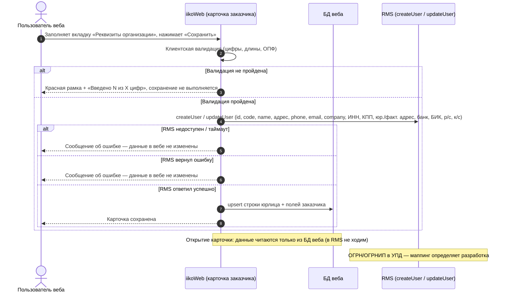

# Реквизиты юр.лица заказчика

**Jira: PB-5671**

<!-- При размещении в Confluence сразу после заголовка вставить макрос Jira для PB-5671. -->

**Оглавление**

- [Общая информация](#общая-информация)
- [Лицензии, фича-флаги, права](#лицензии-фича-флаги-права)
- [Цель](#цель)
- [◇ As is / To be](#-as-is--to-be)
- [◇ Границы задачи](#-границы-задачи)
- [User Story](#user-story)
- [Визуальное описание решения](#визуальное-описание-решения)
- [Критерии приёмки](#критерии-приёмки)
- [Основные сценарии](#основные-сценарии)
- [◇ Источник правды по реквизитам](#источник-правды-по-реквизитам)
- [◇ Состав и поведение вкладки «Реквизиты организации»](#состав-и-поведение-вкладки-реквизиты-организации)
- [◇ Бизнес-правила](#бизнес-правила)
- [◇ Данные](#данные)
- [◇ Интеграции](#интеграции)
- [◇ Печатная форма УПД](#печатная-форма-упд)
- [◇ Схемы](#схемы)
- [◇ Ошибки и edge cases](#ошибки-и-edge-cases)
- [◇ Нефункциональные требования](#нефункциональные-требования)
- [◇ Вопросы к разработке](#-вопросы-к-разработке)

---

## Общая информация

В карточку внешнего заказчика добавляется вкладка «Реквизиты организации» (Левое меню → Ежедневные операции → Производство → Заказчики): реквизиты сохраняются в вебе и передаются в RMS.

---

## Лицензии, фича-флаги, права

| | |
|---|---|
| Фича флаг | REQUISITES_EXTERNAL_CUSTOMER |
| Модуль ID | Module ID: 21093209, продукт: EXTERNAL_CUSTOMERS |

Фича-флаг REQUISITES_EXTERNAL_CUSTOMER:

- Включён: отображается вкладка «Реквизиты организации», доступны заполнение реквизитов и их перенос в УПД.
- Отсутствует или выключен: вкладка и указанная функциональность недоступны.
- После выключения ранее включённого флага реквизиты не удаляются из БД.

Права: чтение и изменение реквизитов доступны пользователям с соответствующими существующими правами на заказчика. При отсутствии прав доступ отклоняется.

---

## Цель

**Проблема.** Заказчиком производства выступают компании (юрлица) и индивидуальные предприниматели. При отгрузке оформляются документы (расходная накладная, УПД, счёт), в которых должны быть официальные данные заказчика. Сейчас в карточке заказчика этих данных нет — только название, контакты и адрес доставки.

**Цель доработки.** Сохранять реквизиты организации в карточке заказчика вместе с остальными данными и выводить их в печатной форме УПД — без ручного ввода данных в бэк-офисе RMS.

**Критерий успеха.** Реквизиты заказчика видны в печатной форме УПД.

**Для кого.**
- менеджер и бухгалтерия производства — ведут реквизиты заказчика в одном месте (в карточке), без переноса данных из бэк-офиса RMS;
- заказчик (юрлицо/ИП) — получает корректно оформленные документы со своими реквизитами.

---

## ◇ As is / To be

### As is

1. В БД веба есть таблица данных заказчика `inv_purchasing_external_customer`.
2. Внешний заказчик в RMS — сущность `User` («гость», `client=true`). Один заказчик = один гость.
3. Карточка и список заказчиков читаются **только из БД веба** — в RMS за данными не ходим.
4. При создании/редактировании заказчика данные пишутся **и в веб, и в RMS**: `POST /resto/services/users?methodName=createUser` (создание) / `updateUser` (редактирование).
5. Сейчас в RMS передаются: `id`, `code`, `name` («Имя в системе» = Название), `firstName`, `lastName`, `client=true`, `address` (адрес доставки для ЛК), `phone`, `email`, `company` (пока = Название).
6. В RMS `User` есть атрибуты под большинство реквизитов: `company` («Компания»), `taxpayerIdNumber` (ИНН), `accountingReasonCode` (КПП), `legalAddress`, `actualAddress`, `bank`, `bik`, `settlementAccount`, `correspondentAccount`, а также `registrationNumber`, `gln`, `businessClassificationCode` (ОКПО), `economicActivityClassificationCode` (ОКДП), `swiftBic`, `iban`.
7. Изменения, сделанные в RMS, в веб не приходят: синхронизации RMS → веб по заказчику нет.

### To be

Реквизиты сохраняются в вебе, передаются в RMS по существующим правилам систем и используются в УПД. Доступность определяется фича-флагом.

## ◇ Границы задачи

Входит: вкладка «Реквизиты организации» в карточке внешнего заказчика (отображение, ввод, изменение, сохранение, маски и валидация, поведение радиогруппы ОПФ); хранение реквизитов в БД веба; расширение API карточки заказчика; передача реквизитов в RMS при сохранении и обработка ошибок RMS; каскадные soft-delete и restore; вывод реквизитов в печатной форме УПД; обратная совместимость для заказчиков без реквизитов.

Не входит: синхронизация RMS → веб; миграция существующих данных и массовая перезапись атрибута «Компания»; изменение методов RMS (`createUser`/`updateUser` — меняется только набор передаваемых полей); вывод реквизитов в список заказчиков; вывод реквизитов в расходную накладную и счёт; EDI и подтягивание реквизитов по ИНН.

## User Story

**Как** менеджер производства,

**я хочу** вести реквизиты организации в карточке внешнего заказчика,

**чтобы** документы (УПД) формировались с официальными данными заказчика.

---

## Визуальное описание решения

**Прототип:** [yur-lico-rekvizity_16.html](yur-lico-rekvizity_16.html).

**Промпт к прототипу:** [rekvizity-prototype-prompt.md](rekvizity-prototype-prompt.md).

Материалы размещаются вложениями статьи Confluence или файлами директории задачи в GitLab. HTML демонстрирует интерфейс, операции RMS и печати не выполняются. Промпт описывает целевое поведение с учётом уточнений; проверка воспроизводимости в других LLM ещё не проводилась. В HTML остаются демонстрационные упрощения: активная кнопка сохранения при создании, недоступная вкладка настроек ЛК при создании, отсутствие ограничения длины текстовых полей и персистентного сохранения. Требования к реализации определяются PRD.

---

## Критерии приёмки

- [ ] В карточке внешнего заказчика есть вкладка «Реквизиты организации» с полями: полное наименование, организационно-правовая форма, ИНН, КПП, ОГРН/ОГРНИП, юридический адрес, фактический адрес, банк, БИК, расчётный счёт, корреспондентский счёт. Все поля ручного ввода необязательные; организационно-правовая форма всегда выбрана; карточка сохраняется с частично заполненными реквизитами. Состав элементов, их типы и поведение — в разделе «Состав и поведение вкладки „Реквизиты организации“».
- [ ] Пользователь может ввести и изменить каждое поле реквизитов; реквизиты сохраняются вместе с остальными данными карточки по одному действию (кнопка «Сохранить») и отображаются при каждом повторном открытии карточки.
- [ ] Организационно-правовая форма: «Юридическое лицо» (значение по умолчанию) или «Индивидуальный предприниматель»; состояние «ничего не выбрано» невозможно.
- [ ] При изменении организационно-правовой формы значения полей ИНН, КПП и ОГРН/ОГРНИП очищаются.
- [ ] Длины цифровых полей: ИНН — 10 цифр (юрлицо) / 12 цифр (ИП); КПП — 9 цифр; ОГРН — 13 цифр (юрлицо); ОГРНИП — 15 цифр (ИП); БИК — 9 цифр; расчётный счёт — 20 цифр; корреспондентский счёт — 20 цифр. Принимаются только цифры 0–9.
- [ ] Поле КПП доступно для ввода, когда выбрана форма «Юридическое лицо».
- [ ] Если хотя бы одно цифровое поле (ИНН, КПП, ОГРН/ОГРНИП, БИК, расчётный счёт, корреспондентский счёт) заполнено не полностью (введено меньше цифр, чем требуется), сохранение карточки отклоняется, проблемные поля подсвечиваются с сообщением «Введено N из X цифр».
- [ ] Признак «Совпадает с юридическим адресом» заполняет поле «Фактический адрес» значением юридического адреса в реальном времени и делает его недоступным для редактирования; при снятии признака фактический адрес остаётся редактируемым с сохранённым значением. Если сохранить карточку с включённым чекбоксом, после повторного открытия он остаётся включённым, оба поля адреса заполнены сохранённым значением, фактический адрес недоступен для редактирования.
- [ ] У поля «Юридический адрес» отображается подсказка с пояснением, какие данные вносить.
- [ ] Длины текстовых полей: полное наименование — 500, юридический и фактический адрес — 500, банк — 250; формат не валидируется.
- [ ] При сохранении карточки реквизиты передаются в RMS вместе с существующими полями — для тех реквизитов, под которые в карточке контрагента RMS есть атрибуты (маппинг — в разделе «Интеграции»).
- [ ] Если RMS вернул ошибку или недоступен, сохранение карточки отклоняется, пользователь получает сообщение, а данные в вебе и RMS остаются неизменными (сохранение применяется в обоих хранилищах либо ни в одном).
- [ ] При недоступности RMS карточка показывает ранее сохранённые реквизиты.
- [ ] При удалении заказчика реквизиты сохраняются (soft-delete) и восстанавливаются вместе с ним.
- [ ] Для заказчиков без заполненных реквизитов поведение карточки, списка и операций создания, редактирования, удаления и восстановления не меняется.
- [ ] Атрибут RMS «Компания» (`company`) меняется на полное наименование только в момент сохранения карточки, в которой пользователь заполнил поле «Полное наименование»; массовая перезапись и миграция существующих данных не выполняются.
- [ ] В печатной форме УПД выводятся реквизиты заказчика — весь набор из карточки, включая ОГРН/ОГРНИП.
- [ ] Чтение и изменение реквизитов недоступны пользователю, не имеющему прав на соответствующего заказчика.

---

- [ ] При включённом флаге вкладка, заполнение и перенос в УПД доступны; при отсутствующем или выключенном флаге недоступны.
- [ ] Выключение флага не удаляет ранее сохранённые реквизиты из БД.

## Основные сценарии

**Сценарий 1: создание заказчика с реквизитами.**

Дано: открыта форма создания заказчика, обязательные поля «Основной информации» и внешнее меню заполнены.

Когда: пользователь заполняет вкладку «Реквизиты организации» и нажимает «Сохранить».

Тогда: карточка создана, реквизиты сохранены в БД веба и переданы в RMS.

**Сценарий 2: повторное открытие карточки.**

Дано: заказчик с сохранёнными реквизитами.

Когда: пользователь открывает карточку.

Тогда: вкладка показывает ранее сохранённые реквизиты (данные берутся из БД веба).

**Сценарий 3: частично заполненные реквизиты.**

Дано: заполнены, например, только ИНН и Банк.

Когда: пользователь нажимает «Сохранить».

Тогда: карточка сохраняется, пустые поля допустимы.

**Сценарий 4: смена организационно-правовой формы.**

Дано: выбрано «Юридическое лицо», заполнены ИНН (10), КПП, ОГРН (13).

Когда: пользователь выбирает «Индивидуальный предприниматель (ИП)».

Тогда: ИНН, КПП, ОГРН очищены; ИНН ожидает 12 цифр; КПП недоступно; ОГРН/ОГРНИП ожидает 15 цифр.

**Сценарий 5: неполное цифровое поле.**

Дано: выбрано «Юридическое лицо».

Когда: введено 9 цифр ИНН и нажата кнопка «Сохранить».

Тогда: сохранение отклонено, поле подсвечено красным, сообщение «Введено 9 из 10 цифр».

**Сценарий 6: недопустимые символы.**

Дано: поле ИНН в фокусе.

Когда: пользователь вводит буквы или спецсимволы.

Тогда: ввод не принимается (только цифры 0–9).

**Сценарий 7: совпадение адресов.**

Дано: юридический адрес заполнен.

Когда: пользователь устанавливает чекбокс «Совпадает с юридическим адресом» и затем правит юридический адрес.

Тогда: фактический адрес недоступен для правки, значение копируется и обновляется в реальном времени. Когда пользователь снимает чекбокс — фактический адрес становится редактируемым, скопированное значение сохраняется. Если сохранить карточку с включённым чекбоксом, после повторного открытия он остаётся включённым, оба поля адреса заполнены сохранённым значением, фактический адрес недоступен для редактирования.

**Сценарий 8: ошибка или недоступность RMS.**

Дано: карточка с заполненными реквизитами.

Когда: пользователь нажимает «Сохранить», RMS вернул ошибку или недоступен.

Тогда: сохранение отклонено, пользователю показано сообщение, данные в вебе и RMS не изменены.

**Сценарий 9: удаление и восстановление заказчика.**

Дано: заказчик с реквизитами.

Когда: заказчик удалён, затем восстановлен.

Тогда: реквизиты помечены удалёнными вместе с заказчиком и восстановлены вместе с ним.

**Сценарий 10: заказчик без реквизитов.**

Дано: заказчик, у которого реквизиты не заполнены.

Когда: пользователь открывает карточку и список, создаёт/редактирует/удаляет/восстанавливает заказчика.

Тогда: поведение не меняется, поля ручного ввода пустые, форма по умолчанию — «Юридическое лицо», атрибут `company` в RMS остаётся равным «Названию».

**Сценарий 11: нет прав на заказчика.**

Дано: у пользователя нет прав на соответствующего заказчика.

Когда: он пытается прочитать или изменить реквизиты.

Тогда: доступ отклонён.

---

**Сценарий 12: выключение фича-флага.**

Дано: флаг включён, реквизиты заполнены и сохранены.
Когда: флаг выключают.
Тогда: вкладка, заполнение и перенос реквизитов в УПД недоступны; реквизиты остаются в БД.

**Сценарий 13: формирование УПД.**

Дано: флаг включён, реквизиты сохранены и переданы в RMS по действующим правилам систем.
Когда: пользователь формирует печатную форму УПД.
Тогда: реквизиты выводятся в УПД, включая ОГРН/ОГРНИП; технический маппинг определяет разработчик.

## ◇ Источник правды по реквизитам
Веб — единственный источник правды по реквизитам заказчика: реквизиты вводятся и меняются только в карточке заказчика в вебе, обратная синхронизация RMS → веб не реализуется. Карточка и список читаются только из БД веба; при включённом флаге сохранение передаёт реквизиты в RMS по действующим правилам сериализации: непустые значения обновляют RMS, пустые не передаются и не стирают старые значения RMS.

Подтверждённые правила систем (сохраняются в этой задаче): технически запретить правку реквизитов в бэк-офисе RMS нельзя. Если реквизиты изменили в RMS, веб об этом не узнает, и при следующем сохранении карточки значения в RMS будут перезаписаны веб-значениями. Мера — организационная: реквизиты заказчиков ведутся только в вебе (зафиксировать в инструкции для внедрения/поддержки и в обучении). Дополнительно: пустые значения в XML не сериализуются (поведение `arrayToXml`), поэтому сохранение карточки с незаполненными реквизитами не стирает их в RMS целиком, но любое ненулевое значение из веба перезапишет значение в RMS.

## ◇ Состав и поведение вкладки «Реквизиты организации»
Порядок вкладок карточки: «Основная информация» → «Реквизиты организации» → «Настройки ЛК заказчика».

| Наименование элемента | Тип | Обязательность | Требования |
|---|---|---|---|
| Полное наименование | поле ввода | необязательное | официальное наименование по уставным документам; максимум 500 символов; без валидации формата |
| Организационно-правовая форма | радиогруппа из двух переключателей: «Юридическое лицо (ООО и др.)» / «Индивидуальный предприниматель (ИП)» | один вариант выбран всегда, по умолчанию «Юридическое лицо»; переключить в «ничего не выбрано» нельзя | переключает поведение трёх полей — ИНН, КПП, ОГРН/ОГРНИП. Юрлицо: ИНН 10 цифр, КПП доступно (9 цифр), ОГРН 13 цифр. ИП: ИНН 12 цифр, КПП недоступно, ОГРНИП 15 цифр |
| ИНН | поле ввода | необязательное | маска по количеству символов: 10 цифр для юрлица, 12 — для ИП; только цифры 0–9; если заполняется — нужно ввести все цифры до конца; при нехватке — красная рамка и «Введено N из X цифр» |
| КПП | поле ввода | необязательное | маска 9 знаков; доступно к заполнению только для юрлица; только цифры 0–9; заполняется целиком; при нехватке — красная рамка и «Введено N из X цифр» |
| ОГРН/ОГРНИП | поле ввода | необязательное | 13 цифр для юрлица (ОГРН), 15 цифр для ИП (ОГРНИП); только цифры 0–9; заполняется целиком; при нехватке — красная рамка и «Введено N из X цифр» |
| Юридический адрес | многострочное поле | необязательное | максимум 500 символов; без валидации формата; по наведению на значок «i» — подсказка: «Адрес по учредительным документам и выписке из ЕГРН: индекс, регион, населённый пункт, улица, дом, офис/помещение (при наличии).» |
| Совпадает с юридическим адресом | чекбокс | — | при включении копирует текущее значение «Юридического адреса» в «Фактический адрес» и делает фактический адрес недоступным для редактирования; при дальнейшем редактировании юридического адреса копия обновляется в реальном времени, пока чекбокс включён; при выключении фактический адрес становится редактируемым, сохраняя скопированное значение |
| Фактический адрес | многострочное поле | необязательное | максимум 500 символов; без валидации формата |
| Банковские реквизиты | заголовок блока | — | — |
| Банк | поле ввода | необязательное | максимум 250 символов; без валидации формата |
| БИК | поле ввода | необязательное | маска 9 символов; только цифры 0–9; заполняется целиком; при нехватке — красная рамка и «Введено N из X цифр» |
| Расчётный счёт | поле ввода | необязательное | маска 20 символов; только цифры 0–9; заполняется целиком; при нехватке — красная рамка и «Введено N из X цифр» |
| Корр. счёт | поле ввода | необязательное | маска 20 символов; только цифры 0–9; заполняется целиком; при нехватке — красная рамка и «Введено N из X цифр» |
| Сохранить | кнопка | — | создание: доступна, когда заполнены обязательные поля вкладки «Основная информация» (Наименование, Имя, Телефон, эл. почта) и вкладки «Настройки ЛК» (внешнее меню); редактирование: доступна, если внесены изменения |
| Удалить | кнопка | — | при создании не отображается; при редактировании доступна: по клику заказчику проставляется признак «Удалён», переход к списку заказчиков |
| Назад | кнопка | — | переход к списку заказчиков; несохранённые данные не сохраняются |
| Восстановить | кнопка | — | поведение не меняется |

Значения полей ИНН, КПП и ОГРН/ОГРНИП при переключении организационно-правовой формы сбрасываются.

## ◇ Бизнес-правила
| ID | Правило |
|---|---|
| БП-1 | Все поля ручного ввода необязательные; организационно-правовая форма всегда выбрана. |
| БП-2 | Организационно-правовая форма — всегда один из двух вариантов, по умолчанию «Юридическое лицо». |
| БП-3 | Смена организационно-правовой формы очищает ИНН, КПП и ОГРН/ОГРНИП. |
| БП-4 | Цифровые поля заполняются либо пустыми, либо целиком; неполное заполнение отклоняет сохранение с указанием полей. |
| БП-5 | Контрольные суммы ИНН, ОГРН и БИК не проверяются — только состав символов и длина. |
| БП-6 | Реквизиты не выводятся в список заказчиков. |
| БП-7 | Реквизиты сохраняются и восстанавливаются каскадно вместе с заказчиком (soft-delete). |
| БП-8 | Массовая перезапись атрибута «Компания» и миграция данных не выполняются. |

## ◇ Данные
Хранение: строка реквизитов организации, связанная 1:1 с заказчиком (в API — объект `jurLegalEntity` в `data` карточки). Существующая таблица данных заказчика — `inv_purchasing_external_customer`. Источник правды — БД веба.

| Поле | Назначение | Ограничения | Обязательность |
|---|---|---|---|
| `full_name` | полное наименование | 500 символов | нет |
| `legal_form` | организационно-правовая форма | ЮЛ / ИП, по умолчанию ЮЛ | да (всегда выбрана) |
| `inn` | ИНН | 10/12 цифр | нет |
| `kpp` | КПП | 9 цифр, только ЮЛ | нет |
| `ogrn` | ОГРН/ОГРНИП | 13/15 цифр | нет |
| `legal_address` | юридический адрес | 500 символов | нет |
| `actual_address` | фактический адрес | 500 символов | нет |
| `bank` | банк | 250 символов | нет |
| `bik` | БИК | 9 цифр | нет |
| `settlement_account` | расчётный счёт | 20 цифр | нет |
| `correspondent_account` | корреспондентский счёт | 20 цифр | нет |
| признак совпадения адресов | состояние чекбокса сохраняется после повторного открытия | булево значение | да |
| признак удаления | soft-delete вместе с заказчиком | — | — |

Имена таблицы и полей — на усмотрение разработки, в ТЗ не зафиксированы.

## ◇ Интеграции
Маппинг «веб → RMS `User`» при сохранении карточки:

| Веб (карточка / строка юрлица) | RMS `User` | Статус |
|---|---|---|
| «Название» (Основная информация) | `name` → `customValue` («Имя в системе») | как сейчас |
| Полное наименование | `company` («Компания») | изменить: сейчас = Название |
| Адрес доставки для ЛК | `address` | как сейчас |
| ИНН | `taxpayerIdNumber` | добавить |
| КПП | `accountingReasonCode` | добавить |
| Юридический адрес | `legalAddress` | добавить |
| Фактический адрес | `actualAddress` | добавить |
| Банк / БИК / р/с / к/с | `bank` / `bik` / `settlementAccount` / `correspondentAccount` | добавить |
| ОГРН/ОГРНИП | определяет разработка после изучения RMS | обеспечить вывод в УПД |

Примечания по интеграции: `firstName`/`lastName` гостя — имя и фамилия контактного лица, сохраняются как сейчас; нулевые значения в XML не сериализуются (поведение `arrayToXml`). Методы RMS не меняются — меняется только набор передаваемых полей.

Эндпоинты карточки заказчика (`ExternalCustomerController`):

| № | Эндпоинт | Изменение |
|---|---|---|
| 1 | `GET /api/inventory/purchasing/external-customer` (список) | без изменений: реквизиты в список не выводятся |
| 2 | `GET /api/inventory/purchasing/external-customer/{id}` (карточка) | в `data` добавить `jurLegalEntity` (из БД веба) |
| 3 | `POST /api/inventory/purchasing/external-customer` (создать) | принять `jurLegalEntity`; создать юрлицо в БД и записать реквизиты в RMS (`createUser`) |
| 4 | `PUT /api/inventory/purchasing/external-customer/{id}` (редактировать) | принять `jurLegalEntity`; upsert в БД и `updateUser` в RMS |
| 5 | `DELETE /api/inventory/purchasing/external-customer/{id}` (пометка удаления) | каскадно soft-delete строки юрлица |
| 6 | `POST /api/inventory/purchasing/external-customer/restore/{id}` (восстановить) | каскадно restore строки юрлица |

## ◇ Печатная форма УПД
Реквизиты организации заказчика выводятся в печатной форме УПД; состав — весь набор из карточки, включая ОГРН/ОГРНИП. Механизм попадания реквизитов в печатную форму в этой задаче не описывается: какие печатные формы правятся, откуда берётся значение и как в печать попадает ОГРН/ОГРНИП — на усмотрение разработки и СА. Реквизиты попадают в документы через карточку контрагента RMS; сама печатная форма — на стороне RMS. Расходная накладная и счёт в эту задачу не входят.

Разработчик самостоятельно исследует существующие печатные формы, находит поля и определяет технический маппинг, включая ОГРН/ОГРНИП. Это часть реализации. Если выявлено ограничение, меняющее требования или объём, согласовать изменение PRD.

## ◇ Схемы
Последовательность на схеме и гарантия применения сохранения в обоих хранилищах либо ни в одном подтверждены владельцем требований как существующее архитектурное поведение систем. Использовать существующий механизм.

## ◇ Ошибки и edge cases
| # | Ситуация | Ожидаемое поведение |
|---|---|---|
| 1 | Цифровое поле заполнено не полностью | отказ сохранения, подсветка поля, «Введено N из X цифр», перечень полей к исправлению |
| 2 | RMS вернул ошибку | отказ сохранения и сообщение пользователю |
| 3 | RMS недоступен (чтение) | реквизиты показываются из БД веба |
| 4 | Смена организационно-правовой формы | поля ИНН, КПП, ОГРН/ОГРНИП очищаются |
| 5 | Удаление и восстановление заказчика | каскад по реквизитам |
| 6 | Пустые реквизиты | штатный режим работы |
| 7 | Нет прав на заказчика | отказ чтения и изменения |
| 8 | Таймаут RMS при сохранении | не описано — уточнить: таймаут, повторная отправка, что видит пользователь |
| 9 | Повторное сохранение (двойной клик) | не описано — уточнить идемпотентность |
| 10 | Превышение длины текстового поля (500/250) | поведение — по готовым паттернам ввода, определяет разработка |
| 11 | Отгрузка заказчику без заполненных реквизитов | предупреждение не выводится: реквизиты просто не попадают в печатную форму |
| 12 | Одновременное редактирование карточки двумя пользователями | реализация — на усмотрение разработки (см. вопросы к разработке) |

## ◇ Нефункциональные требования
| ID | Требование |
|---|---|
| НФТ-1 | Согласованность данных заказчика в вебе и RMS: результат сохранения применяется в обоих хранилищах либо не применяется ни в одном (на момент записи; обратная синхронизация RMS → веб не выполняется). |
| НФТ-2 | Чтение и изменение реквизитов отклоняется для пользователя без прав на заказчика. |
| НФТ-3 | Внедрение изменения не требует миграции существующих данных о заказчиках. |
| НФТ-4 | Добавление реквизитов не влияет на время ответа списка заказчиков. |

## ◇ Вопросы к разработке

| # | Вопрос | Кому |
|---|---|---|
| Q3 | Таймаут и повторная отправка в RMS при сохранении; идемпотентность при повторном сохранении. | разработка |
| Q5 | Одновременное редактирование карточки двумя пользователями: как реализовать. | разработка |
