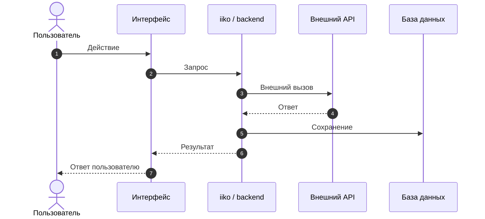
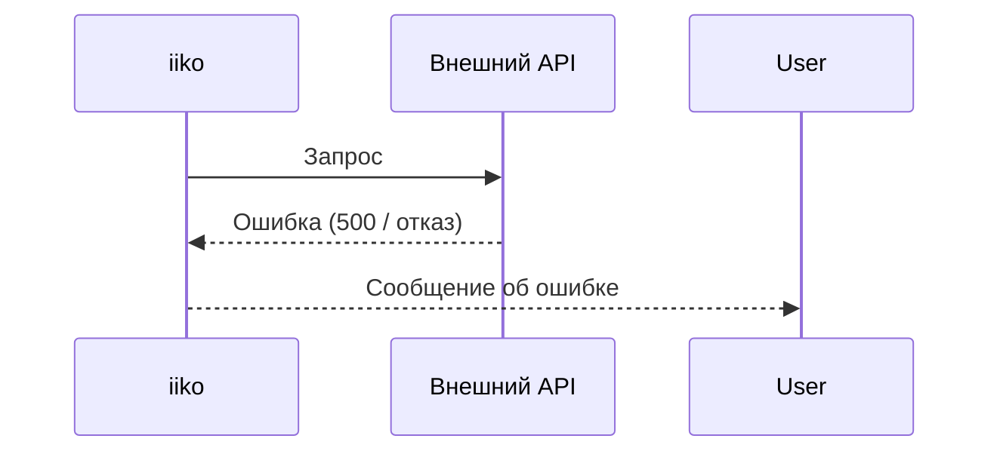
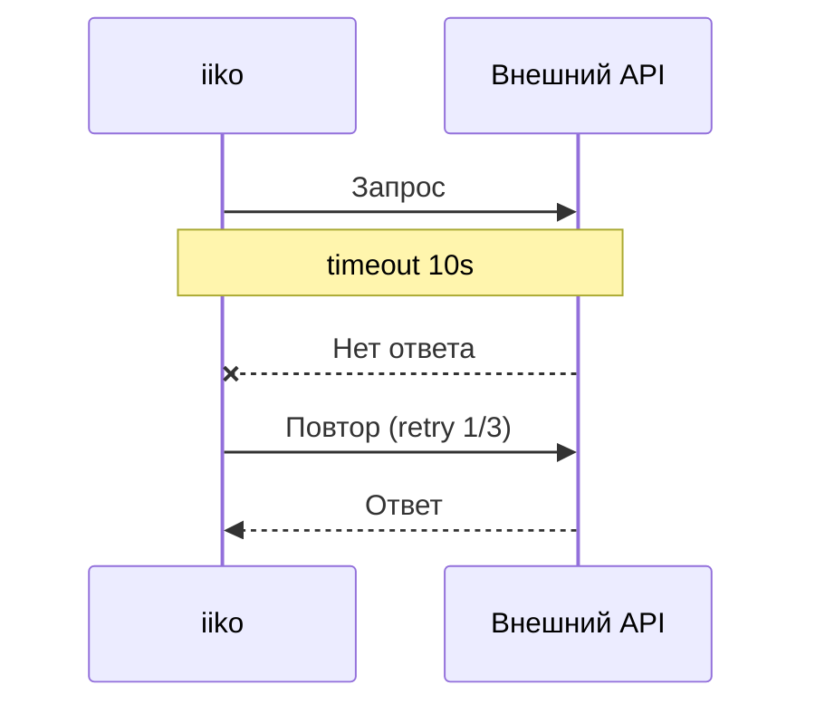
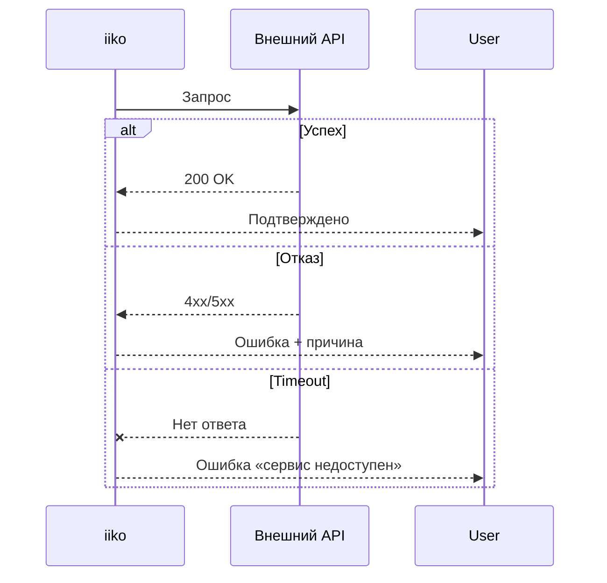
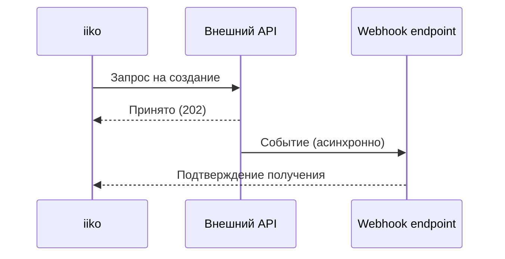

<!-- Источник: скилл spec-writing v2.0 (Александра Коновалова), вложение к странице «Формат PRD» (wiki.iiko.ru, IIKOWEB, pageId 181776249). Файл выгружен в репозиторий 2026-10-01. -->

### Д.3 Sequence diagram (шаблон)

Используй для «Шага 4. Системное взаимодействие». Диаграмма обязана показывать **не только happy path** — добавляй ошибки, retry, timeout и альтернативные ветки, если они влияют на реализацию.

### Базовый каркас

### Как покрывать не-happy path

#### Ошибка внешнего сервиса

#### Timeout и retry

#### Альтернативные ветки (alt / opt)

#### Webhook / асинхронное событие

### Правила

1. **Только реальные системы и события** — не добавляй блоки, которых нет в требованиях.
2. **Один участник = одна система/роль.** Не смешивай UI и backend в одном боксе.
3. **Ошибки и retry/timeout — обязательны**, если задача затрагивает внешние интеграции или асинхронные события.
4. **autonumber** включай, когда на диаграмму будут ссылаться из текста спецификации («см. шаг 3»).
5. Проверяй соответствие: диаграмма не должна противоречить текстовым сценариям (Шаг 5) и разделу To-be.

### Отрисовка

- Если среда поддерживает Mermaid — оставь код-блок, он отрисуется сам.
- Если нет — сгенерируй изображение доступным способом (например, `mmdc`/PlantUML-конвертер) и вставь ссылку на картинку рядом с кодом.
- Никогда не оставляй диаграмму «только текстом», если есть способ её отрисовать.

---
