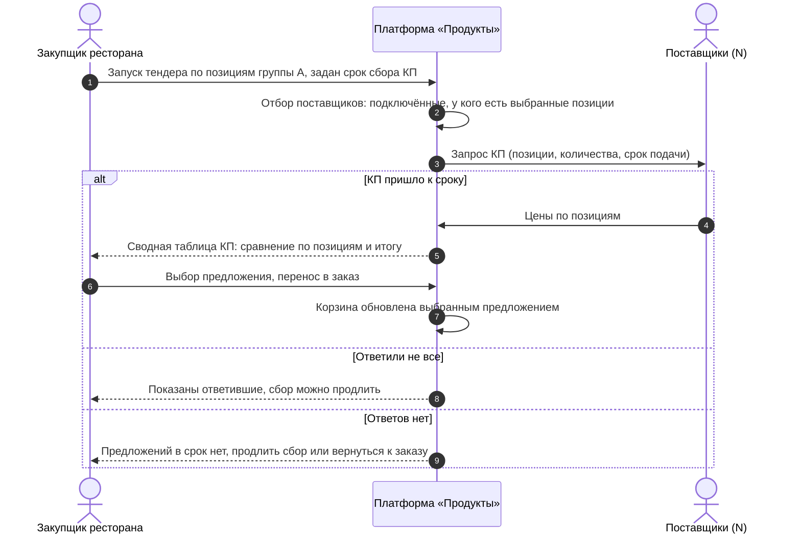
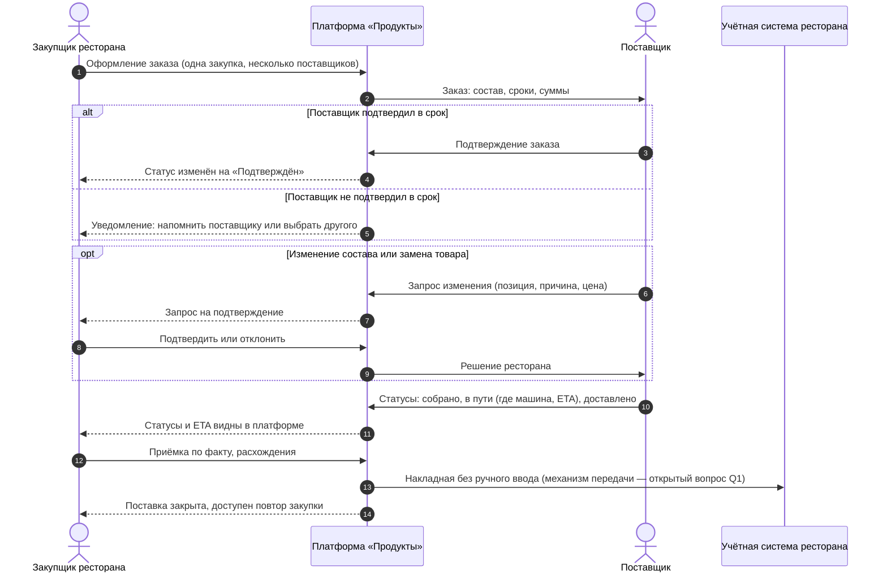
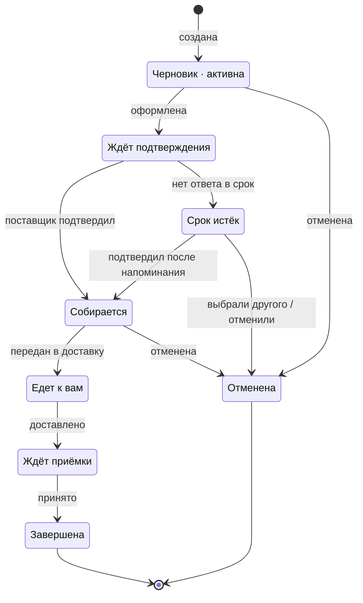

# Закупочная платформа «Продукты» — первая версия

**Jira: PB-…**

<!-- При публикации в Confluence сразу после заголовка ставится макрос Jira (номер присвоится при создании задачи в PB); в MD-версии — строка выше. -->

**Оглавление**

- [Общая информация](#общая-информация)
- [Лицензии, фича-флаги, права](#лицензии-фича-флаги-права)
- [Цель](#цель)
- [◇ As is / To be](#-as-is--to-be)
- [◇ Границы задачи](#-границы-задачи)
- [User Story](#user-story)
- [Визуальное описание решения](#визуальное-описание-решения)
- [Критерии приёмки](#критерии-приёмки)
- [Основные сценарии](#основные-сценарии)
- [◇ Схемы](#-схемы)
- [◇ Данные](#-данные)
- [◇ Нефункциональные требования](#-нефункциональные-требования)
- [◇ Метрики успеха](#-метрики-успеха)
- [◇ Зависимости и ограничения](#-зависимости-и-ограничения)
- [◇ Вопросы к разработке](#-вопросы-к-разработке)
- [◇ Примечания](#-примечания)

---

## Общая информация

«Продукты» — закупочная платформа для ресторанов: ресторан ведёт закупки у всех подключённых поставщиков в одном окне — от поиска и сравнения цен до приёмки поставки и передачи накладной в учётную систему. Первая версия (пилот) закрывает четыре механизма: **единое окно заказов**, **повтор закупок и шаблоны**, **тендеры по группе А**, **прозрачные поставки**.

Проблема: рестораны закупают на фрагментированном рынке — поставщиков ищут вручную, цены почти не мониторятся, заказы живут в мессенджерах и десятках кабинетов поставщиков, исполнение поставок непрозрачно (нет статусов; отмены и замены без предупреждения). Контекст и данные исследований — в материалах задачи (раздел «Примечания»).

Пользователи: **закупщик ресторана** (основной) и **сотрудник поставщика** (кабинет поставщика). Затронутый процесс: закупка продуктов рестораном — от потребности до закрытия поставки и передачи документов в учётную систему.

Первая версия разворачивается как **отдельный продукт вне продуктов iiko web** и включается на пилоте: 3–5 ресторанов, 5–10 поставщиков.

---

## Лицензии, фича-флаги, права

| | |
|---|---|
| Продукт | Закупочная платформа «Продукты» — отдельный продукт вне продуктов iiko web |
| ID модуля / лицензии | Не применимо: продажи нет, первая версия работает на пилоте (при выходе из пилота — отдельное решение). |
| Фича-флаг | Не применимо: доступность регулируется списком участников пилота. |

Доступность:

- Платформа доступна ресторанам и поставщикам, включённым в список пилота (3–5 ресторанов, 5–10 поставщиков).
- Не подключённым ресторанам и поставщикам платформа недоступна.
- При исключении участника из пилота доступ пропадает; ранее сохранённые данные участника сохраняются.

Права:

- **Закупщик ресторана** — полный доступ к закупкам своего ресторана: каталог и цены, корзина, тендеры, заказы, подтверждение изменений и замен, приёмка.
- **Сотрудник поставщика** — доступ только к своим данным: каталог и прайсы, входящие заказы, запросы КП, отгрузка и документы. Данные других поставщиков и ресторанов недоступны.
- Состав ролей внутри ресторана (кто из сотрудников может оформлять заказы и подтверждать замены, несколько закупщиков) и разграничение прав — уточняется (вопрос Q4); при недостатке прав действие пользователю недоступно.

---

## Цель

Ресторан ведёт всю закупку в одном окне: находит товары и сравнивает цены всех подключённых поставщиков, повторяет типовые закупки в пару кликов, снижает цены группы А через тендер и видит прозрачное исполнение поставок — статусы, изменения только с подтверждением, приёмку по факту и накладную в учётной системе без ручного ввода.

Ценность для пользователя — меньше времени на рутину закупки, видимые цены и контроль поставки. Ценность для бизнеса — проверка спроса на платформу и модель закупок на пилоте (3–5 ресторанов, 5–10 поставщиков).

---

## ◇ As is / To be

**As is** (из исследований задачи):

- Заказы собираются вручную в мессенджерах и десятках кабинетов поставщиков — рутина, ошибки, потери.
- Цены меняются еженедельно (порядка 400 позиций в матрице), мониторинга нет — переплаты не видны.
- Предложения сравниваются по витринной цене, без учёта условий.
- Исполнение непрозрачно: статусов нет; отмены и замены — без предупреждения.
- Регулярные закупки собираются поштучно поиском по кабинетам.

**To be** (первая версия):

- Единое окно: каталоги и прайсы всех подключённых поставщиков в одном месте; одна закупочная сессия может включать товары нескольких поставщиков; накладные передаются в учётную систему без ручного ввода.
- Повтор и шаблоны: повтор любого заказа из истории; сохранение типовой закупки как шаблона с правкой перед отправкой.
- Тендер по группе А: автоматический запрос КП у подключённых поставщиков, у которых есть позиции; сводная таблица для сравнения; выбранное предложение переносится в заказ.
- Прозрачные поставки: статусы исполнения в платформе, включая «где машина» и ETA; изменения состава и замены — только после подтверждения рестораном; приёмка по факту с фиксацией расхождений.

---

## ◇ Границы задачи

**Входит в первую версию:**

- Единое окно заказов у нескольких поставщиков (каталог, поиск, цены, корзина, оформление).
- Повтор заказов из истории и шаблоны закупок.
- Тендер по позициям группы А: рассылка запросов КП, сбор, сводная таблица, выбор и перенос в заказ.
- Прозрачные поставки: статусы, «где машина» и ETA, подтверждение изменений и замен, приёмка, передача накладной в учётную систему.
- Кабинет поставщика в объёме первой версии: витрина (каталог и прайсы), входящие заказы, КП по тендерам, отгрузка и статусы, документы.
- Описанные в сценариях альтернативы: пустые состояния, поиск без результатов, тендер без предложений, прерванное оформление, поставщик не подтвердил заказ, отклонённая замена.

**Не входит (за пределами первой версии):**

- Сравнение с полной экономикой закупки (цена + отсрочка + логистика) — отдельная задача.
- Данные о спросе для поставщиков — отдельная задача (ресёч).
- Оплата, отсрочки и взаиморасчёты через платформу — отдельная задача.
- Модель монетизации — отдельное решение (стандарт рынка: платит поставщик).
- Договоры, документооборот сверх передачи накладной, юридически значимый ЭДО — уточняется отдельно.
- Мобильные приложения — первая версия в вебе.

---

## User Story

**Как** закупщик ресторана,
**я хочу** вести закупки всех подключённых поставщиков в одном окне — с повтором типовых закупок, тендером по группе А и прозрачным исполнением поставок,
**чтобы** тратить меньше времени на рутину, видеть цены и не зависеть от звонков, мессенджеров и кабинетов поставщиков.

---

## Визуальное описание решения

Материалы:

- **Прототип**: `produkty-zakupki-mvp.html` (папка `04-дизайн/`; живой адрес: http://hermes.iiko.ru:8331/prototypes/produkty-zakupki-mvp.html). 19 состояний: экран «Закупки» — таблица закупок со статусами (черновик · активна → ждёт подтверждения → собирается → едет к вам → ждёт приёмки → завершена; отклонения: срок истёк, отменена), создание закупки — боковой панелью «Создать закупку» («создание с нуля» или готовые шаблоны; образец — панель «Создать акцию») → каталог → корзина → два пути (оформить напрямую у поставщиков или выйти на тендер) → тендер и сводная таблица КП → замена с подтверждением → приёмка и накладная в учёт → повтор; кабинет поставщика (входящие заказы → КП → отгрузка → документы); альтернативы: поиск без результатов, тендер без ответов, пустой кабинет, неподтверждённый заказ, черновик оформления; справочный экран статусной модели.
- **Промпт к прототипу**: `промпт-к-прототипу.md` (папка `05-спека/`) — самодостаточное описание для воссоздания прототипа.

Что показывает прототип: элементы, состояния и переходы, согласованные с критериями приёмки и сценариями этого документа. Демонстрационные упрощения перечислены в «Примечаниях»; переключатель состояний и пояснения — обвязка ревью, отделённая от продуктового интерфейса.

Итерация 3: экран «Закупки» стал таблицей закупок со статусной моделью (раздел «Схемы»), добавлены выбор «по шаблону или своя» при создании закупки и «напрямую или тендер» после сбора товаров. Итерация 4: «Новая закупка» — боковой панелью (drawer) с шаблонами; карточка закупки «в пути» — над таблицей; товарные списки на всех экранах — таблицами. Не проработаны мобильные состояния.

---

## Критерии приёмки

- [ ] **Единое окно.** Каталог показывает товары и цены всех подключённых поставщиков в одном списке; поиск фильтрует список по мере ввода; в строке товара видны цена, поставщик и наличие.
- [ ] В корзине могут находиться товары нескольких поставщиков одновременно; состав сгруппирован по поставщикам, суммы по каждому поставщику и общий итог рассчитаны верно.
- [ ] Оформление закупки у нескольких поставщиков создаёт заказы по каждому поставщику из этой закупки; заказы появляются в списке заказов со статусом «отправлен».
- [ ] **Повтор.** Любой прошлый заказ можно повторить: корзина заполняется составом этого заказа и открыта для правки перед отправкой.
- [ ] Закупку можно сохранить как шаблон и позже начать из него новую закупку с правкой состава.
- [ ] **Список закупок.** Экран закупок показывает все закупки ресторана одной таблицей с актуальным статусом каждой: черновик · активна, ждёт подтверждения, собирается, едет к вам (с ETA), ждёт приёмки, завершена; отклонения: срок истёк, отменена. В строке — поставщики, сумма и доступное действие (продолжить, детали, разобраться, принять, повторить).
- [ ] **Создание закупки и выбор пути.** При создании новой закупки открывается боковая панель «Создать закупку» (по образцу панели «Создать акцию»): «Создание с нуля» — своя закупка из каталога, или «Готовые шаблоны» — состав подставляется в корзину; после сбора товаров — выбор: оформить заказ напрямую у поставщиков корзины (или у конкретного поставщика) либо выйти на тендер.
- [ ] **Тендер.** Тендер запускается по выбранным позициям группы А из корзины; пользователь задаёт срок сбора предложений (значение по умолчанию — до конца текущего дня).
- [ ] Запрос КП уходит всем подключённым поставщикам, у которых есть выбранные позиции; пользователю виден статус сбора и счётчик ответивших.
- [ ] Сводная таблица показывает цены всех ответивших поставщиков по позициям и итог по каждому предложению; лучший итог отмечен; выбор строки переносит предложение в корзину (состав и цены обновлены).
- [ ] Ответы поставщиков поступают до заданного срока; после срока предложения в сводной таблице не пополняются (поздние ответы не учитываются в тендере без продления).
- [ ] Если к сроку ответили не все — это видно пользователю; доступно продление сбора и выбор из ответивших.
- [ ] Если к сроку не ответил никто — пользователю предложено продлить сбор или вернуться к обычному заказу.
- [ ] **Прозрачность.** Статусы заказа меняются по мере исполнения (отправлен → подтверждён → в пути → доставлен); по поставке видны «где машина» и ожидаемое время (ETA).
- [ ] Изменение состава заказа или замена позиции поставщиком исполняются только после подтверждения рестораном; при отказе заказ исполняется в исходном виде (или корректируется поставщиком).
- [ ] Приёмка: состав поставки виден по факту; расхождения фиксируются и сохраняются в истории; принятая поставка закрывается.
- [ ] Накладная по принятой поставке передаётся в учётную систему ресторана без ручного ввода (механизм — вопрос Q1).
- [ ] **Альтернативы.** Пустое состояние поиска объясняет отсутствие результатов и предлагает действие; при отсутствии истории и шаблонов — предложение собрать первую закупку; прерванное оформление сохраняется черновиком и доступно для продолжения.
- [ ] Если поставщик не подтвердил заказ в срок — ресторан получает уведомление; доступно напомнить поставщику или выбрать другого.
- [ ] **Доступ.** Не подключённому к пилоту ресторану или поставщику платформа недоступна; сотрудник поставщика не видит данные других поставщиков и ресторанов; закупщик не видит данные других ресторанов.

---

## Основные сценарии

**Сценарий 1: закупка из каталога у нескольких поставщиков.**

Дано: ресторан подключён к платформе, к нему подключены не менее двух поставщиков.

Когда: закупщик открывает каталог, находит товары, отмечает нужные у разных поставщиков и оформляет закупку.

Тогда: заказы созданы по каждому поставщику из закупки, видны в списке заказов, поставщики получили их в свои кабинеты.

**Сценарий 2: повтор закупки из истории.**

Дано: в истории ресторана есть прошлые заказы.

Когда: закупщик нажимает «Повторить» у прошлого заказа.

Тогда: корзина заполнена составом этого заказа и открыта для правки; отправка создаёт новую закупку.

**Сценарий 3: закупка из шаблона.**

Дано: у ресторана сохранён хотя бы один шаблон закупки.

Когда: закупщик открывает шаблон, правит состав и оформляет закупку.

Тогда: новая закупка создана из шаблона с учётом правок; шаблон остаётся доступным без изменений.

**Сценарий 4: запуск тендера и сбор предложений.**

Дано: в корзине есть позиции группы А.

Когда: закупщик запускает тендер и задаёт срок сбора.

Тогда: запрос КП отправлен всем подключённым поставщикам, у которых есть эти позиции; закупщику виден статус сбора и счётчик ответивших.

**Сценарий 5: сводная таблица и выбор предложения.**

Дано: к сроку поступили предложения от нескольких поставщиков.

Когда: закупщик открывает сводную таблицу и выбирает предложение.

Тогда: цены сравнимы по позициям и итогу, лучший итог отмечен, выбранное предложение перенесено в заказ (корзина обновлена).

**Сценарий 6: ответили не все поставщики.**

Дано: тендер запущен, к сроку ответила часть поставщиков.

Когда: срок истёк.

Тогда: закупщику показаны ответившие и пометка о неполном сборе; доступно продлить сбор или выбрать из ответивших.

**Сценарий 7: предложений в срок нет.**

Дано: тендер запущен, к сроку никто не ответил.

Когда: срок истёк.

Тогда: закупщику предложено продлить сбор или вернуться к обычному заказу; цены исходной корзины не меняются.

**Сценарий 8: исполнение заказа и статусы.**

Дано: заказ оформлен и получен поставщиком.

Когда: поставщик подтверждает заказ и ведёт поставку (собрано → в пути → доставлено).

Тогда: статусы отображаются в заказе ресторана; в пути видны «где машина» и ETA.

**Сценарий 9: поставщик не подтвердил заказ в срок.**

Дано: заказ отправлен, срок подтверждения истекает.

Когда: поставщик не подтвердил заказ в срок.

Тогда: ресторан получает уведомление; доступно напомнить поставщику или выбрать другого (заказ корректируется).

**Сценарий 10: замена по запросу поставщика — подтверждение.**

Дано: заказ исполняется; поставщик предлагает замену позиции с причиной.

Когда: ресторан подтверждает замену.

Тогда: заказ исполняется с заменённой позицией; цена — по правилам предложенной замены; история заказа фиксирует изменение.

**Сценарий 11: замена отклонена.**

Дано: поставщик предложил замену.

Когда: ресторан отклоняет замену.

Тогда: заказ исполняется в исходном виде (или поставщик корректирует состав); поставщик видит решение.

**Сценарий 12: приёмка с расхождением, накладная в учёте.**

Дано: поставка доставлена; часть позиций отличается по факту (не приехало, меньше количеством).

Когда: ресторан принимает поставку по факту.

Тогда: состав по факту и расхождения зафиксированы; накладная передана в учётную систему без ручного ввода; поставка закрыта; доступен повтор закупки.

**Сценарий 13: пустые состояния.**

Дано: у ресторана нет истории заказов, шаблонов или подключённых поставщиков.

Когда: закупщик открывает кабинет, каталог или вводит поисковый запрос без результатов.

Тогда: платформа объясняет ситуацию и предлагает действие: собрать первую закупку из каталога и сохранить как шаблон; подключить поставщиков; изменить запрос или выбрать категорию.

**Сценарий 14: прерванное оформление.**

Дано: закупщик начал оформление и прервал его (закрыл кабинет).

Когда: закупщик возвращается к закупке.

Тогда: черновик закупки сохранён и доступен для продолжения.

**Сценарий 15: доступ участника пилота.**

Дано: ресторан или поставщик не включён в пилот (или исключён).

Когда: он пытается войти в платформу.

Тогда: доступ отклонён; при исключении данные участника сохраняются без потери.

**Сценарий 16: создание закупки и выбор пути.**

Дано: ресторан начинает новую закупку.

Когда: закупщик открывает боковую панель «Создать закупку» и выбирает «создание с нуля» или готовый шаблон, собирает товары.

Тогда: после сбора предложены два пути — оформить напрямую у поставщиков корзины или выйти на тендер; далее закупка идёт по процессу (подтверждение, статусы, приёмка).

---

## ◇ Схемы

Две sequence-схемы описывают целевое взаимодействие первой версии — не только успешный путь: показаны неполный сбор КП, отсутствие ответов, неподтверждение заказа в срок и изменения состава. Схемы согласованы с требованиями и сценариями; исходники — `схемы/тендер.mmd`, `схемы/исполнение.mmd` (PNG — там же).

Тендер (запуск → рассылка КП → сбор → выбор → перенос в заказ):

Исполнение заказа (оформление → подтверждение → статусы → приёмка → накладная в учёт):

Статусная модель закупки (state):

PNG: `схемы/статусы.png` (исходник — `схемы/статусы.mmd`).

---

## ◇ Данные

- **Каталог и прайсы** — ведёт поставщик в своём кабинете платформы (позиции, цены, единицы измерения, наличие); рестораны видят опубликованные данные всех подключённых поставщиков.
- **Закупки (корзины и черновики), заказы, запросы КП и предложения, статусы, расхождения, история** — данные платформы; для заказов и статусов платформа — источник правды.
- **Накладная** формируется по принятой поставке и передаётся в учётную систему ресторана (механизм — вопрос Q1); после передачи поставка считается закрытой.
- Отображаемые поля позиции каталога (наименование, цена, единица измерения, наличие) — в прототипе; детальный состав полей, обязательность и валидация — на усмотрение разработки, с покрытием сценариев.

---

## ◇ Нефункциональные требования

- Масштаб пилота: 3–5 ресторанов, 5–10 поставщиков; целевое время отклика списков и каталога — уточняется при оценке (Q7).
- Поведение при недоступности учётной системы при передаче накладной (что видит пользователь, как повторяется передача) — уточняется (Q1).
- Доступ по ролям (см. раздел «Лицензии, фича-флаги, права»); изоляция данных участников: ресторан не видит данные других ресторанов, поставщик — других поставщиков.
- Логирование: события аналитики (раздел «Метрики успеха») и история изменений заказа (замены и подтверждения) сохраняются.

---

## ◇ Метрики успеха

| Метрика | Ожидаемое изменение | Источник | Период | Исходное значение |
|---|---|---|---|---|
| Время закупки (от старта закупки до оформления заказа) | снижение | события аналитики платформы | период пилота | не измерялось |
| Доля закупок через повтор и шаблоны | рост | события аналитики платформы | период пилота | не измерялось |
| Срывы поставок (отмены, недовозы, расхождения) | снижение | данные заказов платформы | период пилота | не измерялось |
| Замены, исполненные без подтверждения рестораном | 0 | данные заказов платформы | период пилота | не измерялось |
| Поставки с накладной, переданной в учёт без ручного ввода | 100% | данные платформы | период пилота | не измерялось |

События аналитики (краткий состав, детализация — Q5):

- Закупка: начало закупки (источник: каталог / история / шаблон), поиск (запрос, число результатов), товар добавлен в корзину, заказ оформлен.
- Тендер: тендер запущен, КП получено, тендер завершён (выбор / истечение срока), предложение перенесено в заказ.
- Исполнение: заказ подтверждён / не подтверждён в срок, статус изменён, запрос замены отправлен / подтверждён / отклонён, поставка принята (с расхождением / без), накладная передана в учётную систему.
- Повтор: заказ повторён, шаблон сохранён, закупка начата из шаблона.

---

## ◇ Зависимости и ограничения

Зависимости:

- **Поставщики-партнёры пилота (5–10)** — готовность вести каталог и прайсы в кабинете и работать с заказами на платформе; условие — договорённости пилота.
- **Передача накладной в учётную систему ресторана** — способ передачи определяет разработка (Q1); условие — согласованный механизм.
- **Разметка событий аналитики** — нужна для метрик пилота; состав событий — Q5.
- **Команда и план работ платформы** — определяются вне этого документа.

Ограничения: не заявлены владельцем требований; при выявлении фиксируются в этом разделе.

---

## ◇ Вопросы к разработке

| # | Вопрос | Влияние | Блокирует ли | Кому |
|---|---|---|---|---|
| Q1 | Механизм передачи накладной в учётную систему ресторана (API, файл, ЭДО) и поведение при ошибке или недоступности, повтор передачи. | Критерий «без ручного ввода» и сценарий 12. | Блокирует часть критерия приёмки. | разработка |
| Q2 | Подключение и авторизация поставщиков на платформе (онбординг, учётные записи сотрудников); кто ведёт данные каталога на пилоте. | Раздел «Лицензии, фича-флаги, права», сценарии кабинета поставщика. | Не блокирует ядро закупки. | разработка, продукт |
| Q3 | Поведение, если ресторан не отвечает на запрос замены или изменения (срок, напоминание, эскалация). | Сценарии 10–11. | Не блокирует. | продукт |
| Q4 | Состав ролей и права внутри ресторана: несколько закупщиков, кто может подтверждать замены и принимать поставки. | Раздел «Лицензии, фича-флаги, права», критерий доступа. | Не блокирует. | продукт |
| Q5 | Требования к событиям аналитики (состав, свойства) и целевые значения метрик; где хранятся черновики закупки. | Раздел «Метрики успеха», сценарий 14. | Не блокирует. | продукт, аналитика |
| Q6 | Уведомления: каналы и гарантии доставки (срок КП близко, заказ не подтверждён в срок, результат тендера). | Сценарии 6–9. | Не блокирует. | разработка |
| Q7 | Требования к спискам на объёмах пилота (каталог нескольких поставщиков, время отклика). | Раздел «Нефункциональные требования». | Не блокирует. | разработка |

---

## ◇ Примечания

- Предположения: состав ролей и права — базовое описание (уточняется, Q4); техническая архитектура и стек — на усмотрение команды платформы; данные на экранах прототипа — вымышленные.
- Демонстрационные упрощения прототипа: переключатель состояний и блок пояснений — обвязка ревью, не продуктовый интерфейс; бэкенда, сохранений и реальных уведомлений нет; живой поиск фильтрует данные локально; статусы поставщика и отправка КП/документов переключаются вручную.
- Материалы задачи (источники требований): карточка проблемы, анализ рынка, бенчмарки, JTBD-путь и джобы — папка `01-проблема/исследования/`; описание задачи «Первая версия» — `03-требования/описание-задачи-mvp.md`.
- Промпт к прототипу подготовлен вместе с документом; проверка воспроизводимости в другой модели — при следующем обращении к материалу.
